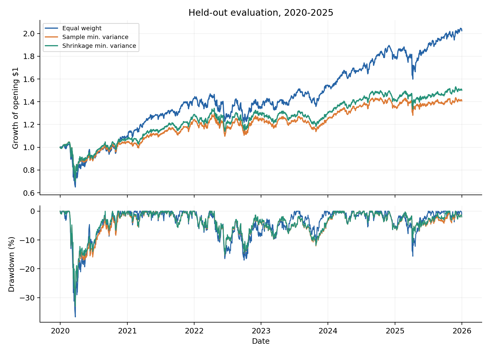
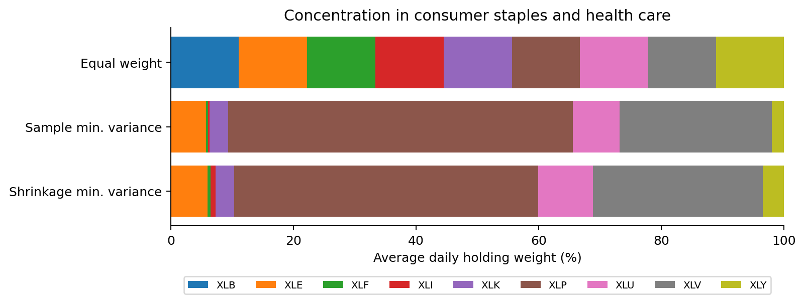

# Quantitative Portfolio Optimisation and Risk Analysis

Does minimum-variance allocation reduce future portfolio volatility compared
with equal weighting, and what does that reduction cost in concentration,
turnover and returns?

This independent student research project compares three long-only portfolios
across nine US sector ETFs: equal weight, sample-covariance minimum variance,
and minimum variance using Ledoit–Wolf covariance shrinkage.

## Main findings

The final historical evaluation covers **2020–2025**, following development on
2006–2019. The baseline uses 252 daily returns to estimate risk, monthly
rebalancing, next-trading-day close execution, and 5 basis points of cost per
dollar bought or sold.

| Portfolio | Annualised volatility | CAGR | Annual one-way turnover | Average largest holding |
|---|---:|---:|---:|---:|
| Equal weight | 19.82% | 12.47% | 17.24% | 11.58% |
| Sample minimum variance | 16.82% | 5.87% | 77.90% | 57.28% |
| Shrinkage minimum variance | 16.84% | 7.00% | 73.95% | 50.50% |

The shrinkage portfolio had **15.0% lower realised volatility** than equal
weighting, alongside lower compound returns and greater concentration and
turnover. Shrinkage reduced concentration and turnover relative to sample
minimum variance, with almost no change in realised volatility.

A predeclared 504-day estimation window also reduced volatility relative to
equal weighting and required less trading than the 252-day window. These are
historical comparisons, not evidence of universal or statistically significant
superiority.

[Read the research report](RESEARCH_FINDINGS.pdf) ·
[View the full result tables](results/RESULTS.md) ·
[Read the code and mathematics walkthrough](WALKTHROUGH.md)





## Research design

- Universe: XLB, XLE, XLF, XLI, XLK, XLP, XLU, XLV and XLY
- Price history: daily provider-adjusted closing prices, 2004–2025
- Portfolio constraints: fully invested, long-only, no leverage or return forecasts
- Risk estimates: sample covariance and Ledoit–Wolf scaled-identity shrinkage
- Estimation windows: 252 daily returns; one predeclared 504-day sensitivity check
- Trading: monthly signals after the close, execution at the following trading-day close
- Accounting: existing holdings earn the execution-day return; holdings drift between trades
- Costs: 0 and 5 basis points per dollar traded, applied to purchases and sales
- Common start: entry on 1 February 2006 after the longer estimation window is available
- Evaluation: development through 2019; a separate 2020–2025 historical test, carrying holdings into 2020
- Outcomes: realised volatility, CAGR, drawdown, turnover and concentration

The primary objective is minimum variance. Lower returns therefore do not
invalidate the optimisation, but they matter when assessing its usefulness.
Concentrated sector exposures also limit what can be attributed to covariance
estimation alone.

## Run the project

Use Python 3.13. From the repository folder:

```bash
python3.13 -m venv .venv
source .venv/bin/activate
python -m pip install -r requirements.txt
python -m unittest -v test_backtest
python download_prices.py
python Portfolio_Research.py --period all
python prepare_outputs.py
```

On Windows, activate the environment with `.venv\Scripts\activate` instead.
Without `--period all`, the main script runs the development period only.
Charts are saved as files; no interactive graphics window is required.

The repository includes selected published results in `results/`. New runs
write to `research/results/`, keeping the published record separate.

Raw provider prices and issuer workbooks are excluded. The downloader obtains
a **new provider snapshot**, which may differ from the original research
vintage. The published numbers above refer to the original snapshot, whose
hashes are recorded in `reference/` and `CODE_FREEZE.json`; a fresh download
does not guarantee exact numerical reproduction. The original full project
package retains the original data for that purpose. The downloader refuses
to overwrite an existing price file.

## Validation and data limitations

Seventeen tests cover optimisation, constraints, holdings drift, transaction
costs, execution timing, evaluation boundaries and a synthetic end-to-end
study. The twelve original full-period portfolio paths were also reconciled
against a separate fixed-unit holdings calculation; the maximum absolute NAV
difference was approximately 2.23e-13.

Selected issuer checks corroborated trading-date coverage, the 2016 XLF
in-kind distribution, the March 2020 XLE fall, ordinary distributions and
December 2025 share splits. They do not independently reproduce every market
price or every reinvestment convention. A difference between the provider's
2016 XLF return and the issuer's published return remains documented.

The adjusted-close series is a total-return proxy. The ETF universe is fixed
with hindsight, sector composition changes over time, and no prospective
live test or formal significance test is claimed. See
[DATA_REVIEW.md](DATA_REVIEW.md) for the completed checks and remaining limits.

`verify_data.py` is an optional audit of the **original** snapshot against its
archived source hashes. It is not a validation shortcut for a newly downloaded
and potentially revised provider history. Optional issuer checks also require
`requirements-audit.txt`.

## Files

| File | Purpose |
|---|---|
| `Portfolio_Research.py` | Portfolio construction, monthly trading and performance metrics |
| `test_backtest.py` | Optimisation, accounting and timing tests |
| `download_prices.py` | Download the fixed ETF universe and historical date range |
| `prepare_outputs.py` | Create charts and summary tables from a saved run |
| `verify_data.py` | Selected issuer cross-checks of the original snapshot |
| `RESEARCH_FINDINGS.pdf` | Final research report |
| `WALKTHROUGH.md` | Explanation of the Python, mathematics and research decisions |
| `DATA_REVIEW.md` | Data checks and unresolved conventions |
| `results/` | Selected tables and figures from the completed study |
| `reference/` | Dated research specification, source hashes and audit records |

Historical freeze records preserve the state before the final evaluation;
their earlier status statements are not the current completion status.

## Background

The project explores an established portfolio-construction question rather
than proposing a new optimiser. Background reading includes DeMiguel,
Garlappi and Uppal (2009), *Optimal Versus Naive Diversification*, and Ledoit
and Wolf (2004), *A Well-Conditioned Estimator for Large-Dimensional Covariance
Matrices*.

Developed as a first-year independent learning project with AI assistance
for implementation, debugging, checks and explanations.
